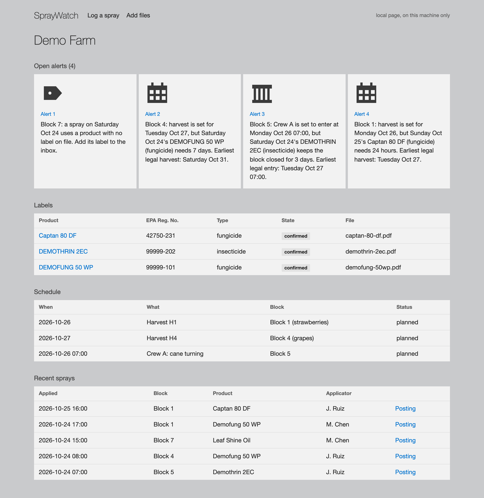
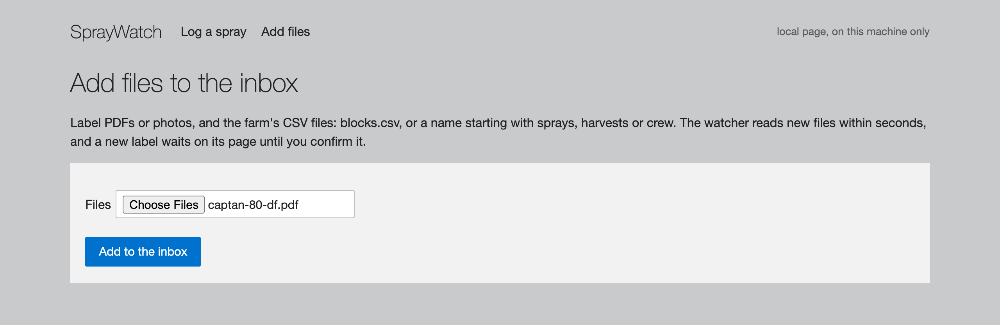
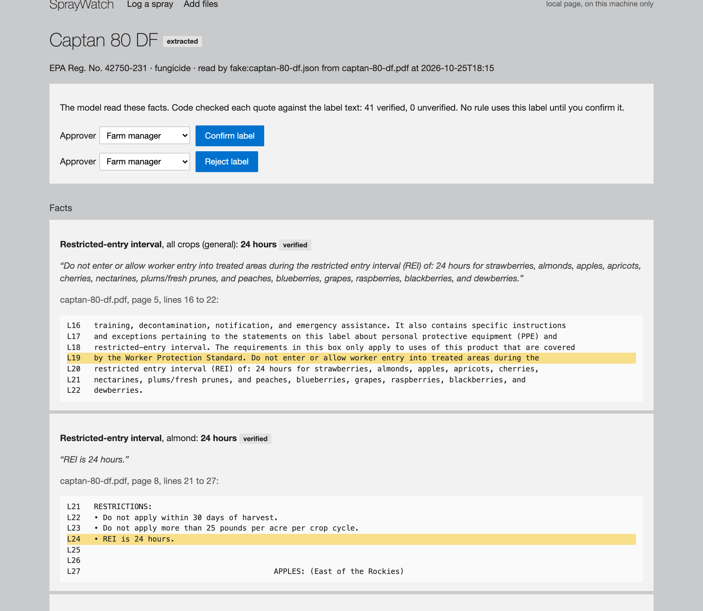
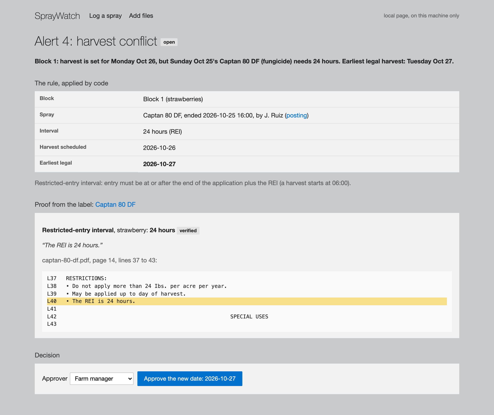
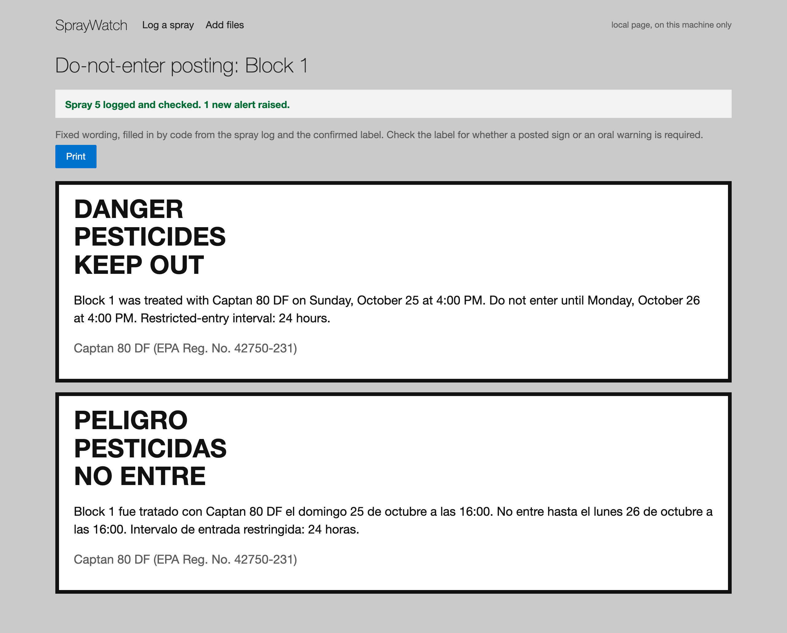

# SprayWatch

A local agent that keeps every harvest and every crew entry inside the pesticide label's limits. It reads the labels, watches the spray log and the schedule, alerts in Slack when they collide, and drafts the do-not-enter posting in English and Spanish.

> Block 4: harvest is set for Thursday Oct 29, but Monday Oct 26's DEMOFUNG 50 WP (fungicide) needs 7 days. Earliest legal harvest: Monday Nov 2.

It's the backup project for ClearFrame, built from the same pieces: the folder watcher, SQLite, the recurring job, the Slack card, the evidence page, approval and the queue. Everything runs on one Dell Pro Max GB10, and nothing calls a cloud model.

## Why

Every pesticide label sets a **pre-harvest interval** (minimum days between spraying and harvest) and a **restricted-entry interval** (how long workers must stay out of a sprayed block). Harvest too early and a load can be rejected for illegal residue. Send a crew in too early and it's a worker-safety violation. Most farms track this on whiteboards and paper logs.

## The loop

1. Label PDFs or photos, and the spray log, harvest and crew schedules as CSV, land in the inbox.
2. Qwen reads each label: the product, both intervals and the per-crop limits, each with the page, line and exact words. Code checks every quote against the label text, and the manager confirms the label on the local page.
3. Code applies the rules ([the contract](contracts/README.md#the-rules)) to every planned harvest and entry. A product with no confirmed label is never treated as safe.
4. A conflict goes to Slack at once, and every morning a digest lists what's still open. Cards come from fixed templates; no model text reaches Slack.
5. The manager opens the alert, sees the label line as proof, and approves the new date. The change goes to the queue for the crew lead or scheduling tool.
6. Every spray gets a printable do-not-enter posting in English and Spanish, from fixed wording.

## Screenshots

The local page on the demo farm, with the real Captan 80 DF label (EPA Reg. No. 42750-231) added through the page. These were taken on a laptop, where the page replays Qwen3.6's saved reply from the GB10; that's why the label page says `read by fake:captan-80-df.json`. DEMOFUNG 50 WP and DEMOTHRIN 2EC are the fictional demo labels.

**Today.** Four open alerts: a product with no label on file (Block 7), a harvest inside a pre-harvest interval (Block 4), a crew entry inside a restricted-entry interval (Block 5), and the Captan alert below (Block 1). Then the labels, the schedule and the spray log.



**Add files.** The manager adds a label PDF or photo, or the farm's CSV files, to the inbox. The watcher reads them within seconds.



**The label, read and checked.** Qwen3.6 proposes each fact with its page, line and exact words. Code checks every quote against the label text (41 of 41 verified) and marks the line. No rule uses the label until the manager confirms it. The first 2 of the 41 facts:



**The alert, with the label as proof.** A Captan spray on Block 1 ended Sunday at 4 PM. Strawberries need 24 hours before anyone goes in, so Monday's 6 AM harvest can't go ahead. Code found the conflict and the earliest legal date, and the label line is the proof. Approving sends the new date to the queue for the crew lead.



**The posting.** Logging the spray checked the schedule at once, raised the alert, and drafted the do-not-enter posting in English and Spanish from fixed wording.



How to retake them: [docs/screenshots/README.md](docs/screenshots/README.md).

## Try it

```bash
make verify                       # the gate: repo checks, secret scan, 70+ tests
sh scripts/fetch_labels.sh        # optional: the real Captan 80 DF label from EPA's PPLS
python3 scripts/demo.py           # the demo farm, today's dates, fake model replies, cards printed
```

Then open the page with the command the demo prints. On the GB10, `python3 scripts/demo.py --live` reads the labels with Qwen; see [docs/gb10.md](docs/gb10.md).

## Measured on the GB10 (October 25, 2026)

Qwen3.6-35B-A3B (NVFP4) on NemoClaw's vLLM, thinking off, temperature 0:

| Label | Facts | Verified by code | Time |
| --- | --- | --- | --- |
| CAPTAN 80 DF, EPA Reg. No. 42750-231 (real, 16 pages) | 41 | 41 | 44 s |
| DEMOFUNG 50 WP (demo) | 3 | 3 | 4 s |
| DEMOTHRIN 2EC (demo) | 4 | 4 | 5 s |

The times are with the GPU otherwise idle; with another job on it, the same labels took 70 to 90 s.

## Layout

| Folder | What |
| --- | --- |
| `contracts/` | [The contract](contracts/README.md) and sample files; change only by pull request |
| `labels/` | Label files to text, the model client, the reader and the quote check |
| `agent/` | SQLite, the rules, the inbox watcher, the check pass, cards, approval, postings |
| `evidence/` | The local page |
| `policy/` | Approvers, times, crop aliases and card templates |
| `demo/` | Fictional demo labels, the model's saved replies, the real-label list |
| `scripts/` | The gate, the demo, label tools |
| `tests/` | Laptop tests: no model, no Slack, no network |
| `docs/` | [Running it on the GB10](docs/gb10.md), and the [screenshots](docs/screenshots/README.md) of the page |

## Rules

Agents and people follow [`AGENTS.md`](AGENTS.md). SprayWatch drafts and checks; it doesn't give legal advice. The label is the law, and the manager decides.
